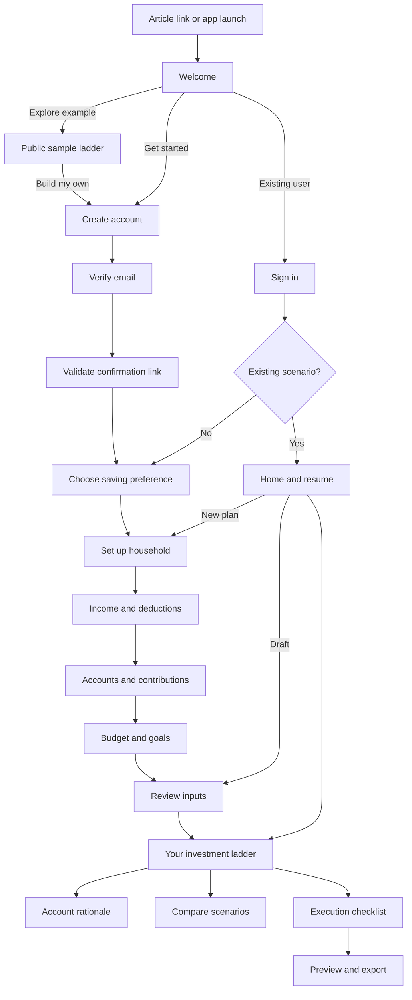
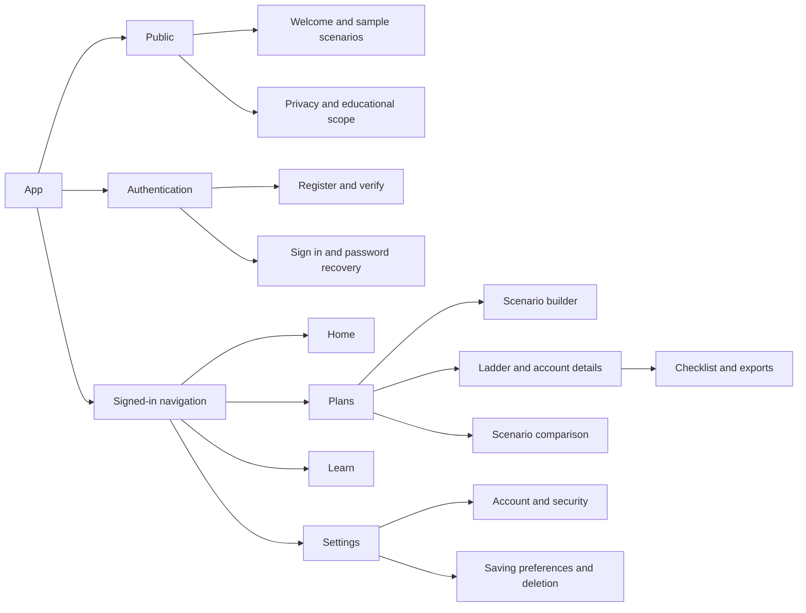
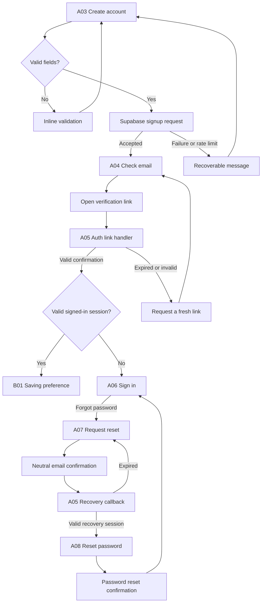
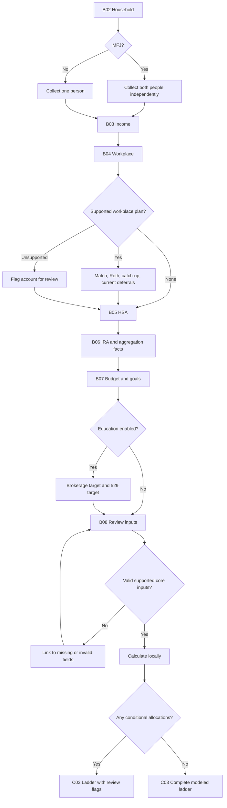
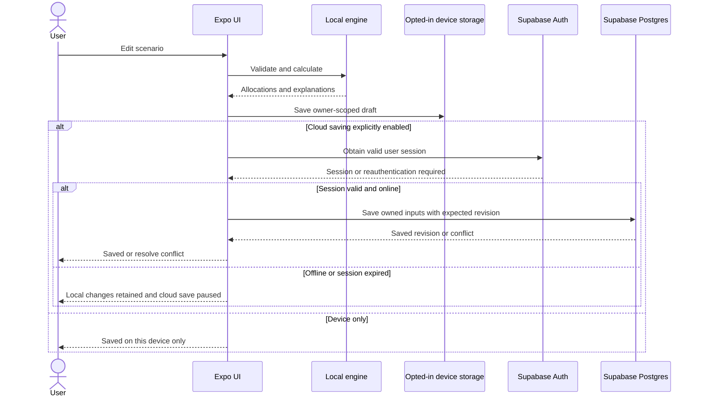
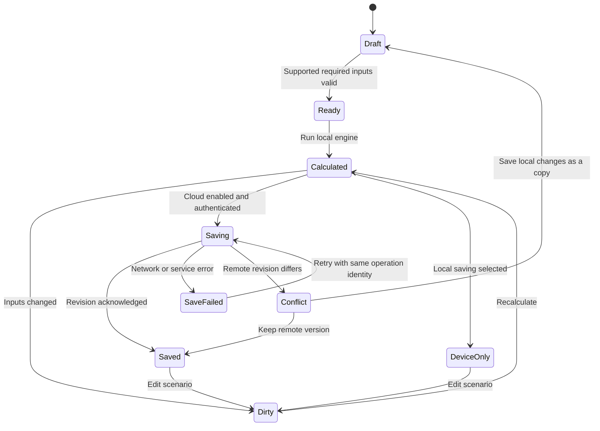
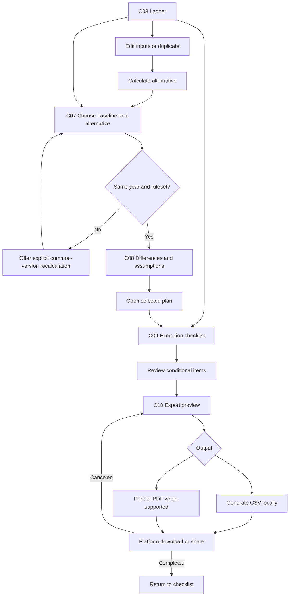
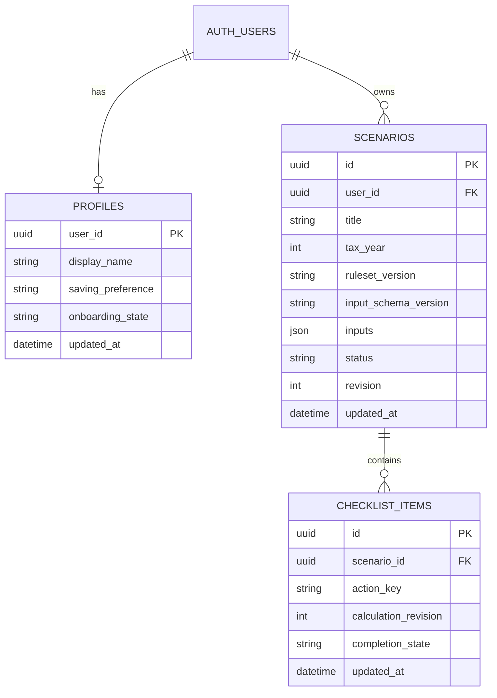
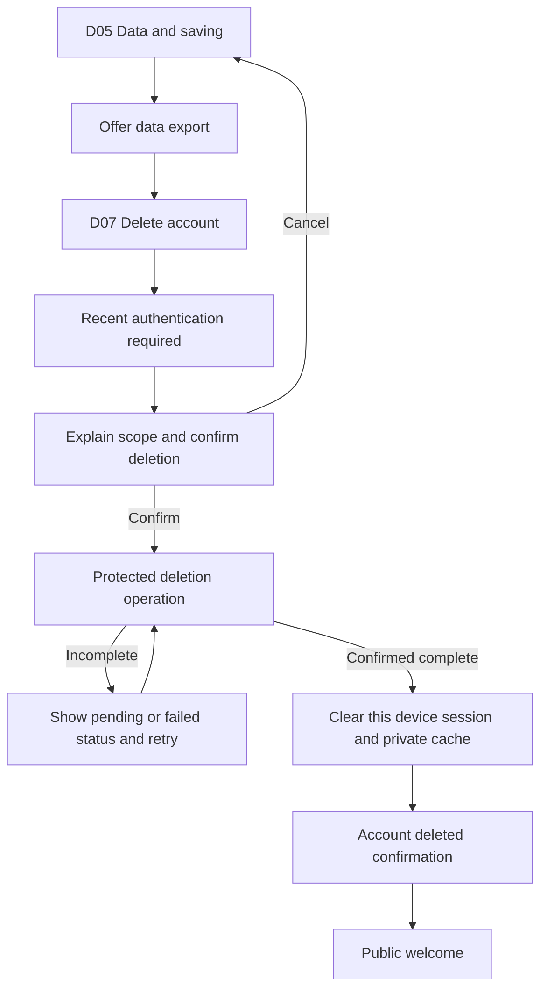

# Investing Order UX and Screen Flows

Prepared November 27, 2026. Design proposal for Expo, Tailwind-styled components, and Supabase. This document defines the experience and screen contracts; it does not implement or provision services.

## 1. Experience and architecture decisions

Help users move from “Where should I invest next?” to an understandable annual allocation and execution checklist. Keep the first journey focused: register, verify email, choose how to save data, enter a household scenario, review the ladder, and export the plan.

This extends the [app plan](./INVESTING_ORDER_APP_PLAN.md). Registration and optional cloud-saved scenarios replace its earlier account-free, local-only scope. Calculations still run on the device. Financial inputs are sent to Supabase only when the user enables cloud saving. Authentication itself sends account information to Supabase regardless of the financial-data saving choice.

Proposed defaults:

- Email/password registration with email verification for MVP. Social sign-in is a later option.
- Public synthetic examples remain available without registering; personal plans require an account in this design.
- Offer “This device only” and “Save across devices” after verification. Default to device-only; explain that cloud saving uploads financial inputs and progress.
- One account owns its household scenarios. Entering spouse information does not invite a spouse or create shared access. Household collaboration is outside MVP.
- Expo Router provides navigation. Tailwind-styled reusable components provide the UI; choose the compatible styling integration during implementation.
- Supabase Auth manages identity; Postgres stores profile preferences and opted-in scenario data. A protected server function handles account deletion. PDFs and CSVs are generated locally; no cloud file storage is needed for MVP.
- Tax Year 2026 is explicit. Offer other years only when their rulesets have been reviewed.

## 2. End-to-end journey

When resuming a draft, return to its first incomplete step, not necessarily Review. The diagram abbreviates that return path. Complete users reach Home on subsequent launches.

## 3. Navigation and screen inventory

Use four main tabs on mobile: **Home**, **Plans**, **Learn**, and **Settings**. Put Compare inside Plans and Checklist inside a selected plan. This avoids crowded navigation. Use a side navigation rail on desktop with the same labels.

Screen IDs below are design references. Suggested paths describe the navigation contract, not implemented files. Drawers and confirmation dialogs are identified so they do not all become separate full-screen routes.

### Entry and authentication

**A01 — Welcome** · `/welcome` · Public. Show the next-dollar promise, an illustrative ladder, the selected tax year, and the article attribution. Primary: “Create my plan.” Secondary: “Sign in” and “Explore an example.” Link to privacy and educational scope without requiring authentication.

**A02 — Sample scenarios** · `/examples` · Public. Choose early-career, split-zone household, or high-income sample. Label all figures as fictional. Open a read-only sample ladder with “Build my own.” Never carry sample values into a personal plan without an explicit “Use as starting point” action.

**A03 — Create account** · `/auth/register`. Collect email, password, password confirmation, and acceptance of applicable terms with linked text. Support password managers and show/hide. Do not collect income here. Primary: “Create account.” Show inline validation, submitting, rate-limited, and recoverable failure states; do not expose account existence through custom lookup endpoints. Newsletter consent, if ever added, is separate and unchecked.

**A04 — Check your email** · `/auth/verify`. Show the destination address, “Open email,” resend with cooldown, and “Change email.” Never claim verification before the callback succeeds. Handle already-used or expired links and let users restart verification without losing a local draft. Changing an unverified address restarts the supported registration flow rather than pretending to edit a verified identity.

**A05 — Auth link handler** · `/auth/callback`. A transient screen validates verification links and routes password-recovery links to password reset. Show progress, success, invalid/expired link, and “Open in the app” recovery guidance where appropriate. Do not display tokens or leave them in analytics or navigation history. A link opened on another device must either complete successfully there or explain how to restart; no endless spinner.

**A06 — Sign in** · `/auth/sign-in`. Email/password, show/hide password, “Forgot password,” and “Create account.” Return users to their intended protected screen after success. Use generic sign-in failure copy; offer verification assistance for supported unverified-account responses.

**A07 — Forgot password** · `/auth/forgot-password`. Collect email. Primary: “Send reset link.” Use neutral confirmation copy, a resend cooldown, and a route back to sign-in. Preserve no password values when navigating away.

**A08 — Reset password** · `/auth/reset-password`. Available only after a valid recovery session. Collect and confirm the new password; handle expired recovery sessions with a fresh-link action. After success, show confirmation and route through the supported sign-in/session policy. Password recovery must not accidentally open the household wizard before the reset is finished.

**A09 — Session expired** · Modal over protected screens. Explain “Sign in again to save your changes.” Keep the current draft in memory; persist locally only if that device-saving choice is enabled. Pause cloud writes. After reauthentication as the same user, return to the exact screen; signing in as another user must not attach the previous user’s draft automatically.

### First-run setup and scenario builder

**B01 — Welcome and saving preference** · `/onboarding/saving`. Optional display name, short educational scope, and the two saving modes. Explain what each stores before selection. Primary: “Continue.” Cloud saving is an explicit opt-in, distinct from accepting terms. Device-only users still have a Supabase account but their financial scenarios are not uploaded.

**B02 — Household** · `/plans/new/household`. Plan name, tax year, Single/MFJ, each person’s age, and an investing-readiness prompt. Show spouse fields only for MFJ. A spouse is a person in the scenario, not another app user. Unsupported statuses get an explanation and a link to methodology; do not silently map them to Single.

**B03 — Income and deductions** · `/plans/new/income`. Separate each person’s gross wages, supported other income, deductions, and any advanced estimated-income mode. Explain whether wages are before payroll deferrals. Mark preferential-income or complex-tax cases as unsupported for precise estimates until their logic is available. Primary: “Continue to accounts.” Inline errors link to the relevant fields.

**B04 — Workplace plans** · `/plans/new/workplace`. Per person: plan access, supported type, eligible salary, match formula, contributions to date, future contributions outside this budget, Roth availability, catch-up availability, and relevant prior-year wages. “No workplace plan” is a valid path. Tiered matches or simultaneous unsupported plans trigger manual-review guidance. A detail drawer explains the match calculation and payroll true-up question.

**B05 — HSA eligibility** · `/plans/new/hsa`. Coverage type, full-year eligibility, employer and employee contributions, age-based catch-up facts, and Medicare/disqualifying coverage. Skip contributions if ineligible. For unsupported coverage changes, keep the rest of the plan usable while marking HSA allocation pending review. Explain the shared family limit and separate spouse catch-up accounts.

**B06 — IRA details** · `/plans/new/ira`. Per person: contributions to date, traditional/SEP/SIMPLE balances, known nondeductible basis, and “I’m not sure.” Explain why aggregation matters. Unknown inputs produce a conditional IRA recommendation rather than assumed tax-free backdoor treatment. Direct contribution eligibility is calculated after the final proposed deductions.

**B07 — Budget and goals** · `/plans/new/goals`. Remaining contribution-dollar budget, retirement-bracket preference, and optional education target. Explain that modeled tax savings are displayed separately. If education is enabled, require a user-selected annual brokerage target, including an explicit zero option. Show simple monthly equivalents without implying payroll changes have been made.

**B08 — Review inputs** · `/plans/new/review`. Summarize each section with Edit links, selected saving mode, assumptions, supported scope, and missing facts. Primary: “Build my ladder.” Block only issues that prevent a valid result; clearly label partial results where optional accounts need review. Preserve prior input on validation errors.

Use these builder screens when editing an existing plan, with the plan ID in the route. Back keeps entered values. Closing offers Continue later or Discard when needed; it never silently loses edits. Start with the expanded steps above rather than squeezing all account questions into one long two-step form.

### Core plan and action screens

**C01 — Home** · `/home`. For a new user: “Create your first plan.” For a returning user: active plan, next dollar target, last calculated date, ruleset year, saving status, and “Resume draft” or “View ladder.” Show an annual review prompt when the plan’s tax year is old. A cloud loading error is distinct from having no plans.

**C02 — Plans** · `/plans`. List drafts and completed scenarios with year, last update, and device/cloud badge. Actions: Open, Rename, Duplicate, Compare, and Delete. No account balances on list previews by default. Empty state offers a personal plan or a fictional example. Duplicating does not overwrite the original.

**C03 — Investment ladder** · `/plans/:id/ladder`. Lead with marginal bracket before/after, estimated modeled tax reduction, Roth/HSA contribution totals, and remaining flexible savings. Show ordered cards with owner, allocation, capacity, treatment, and rationale. Preserve match/HSA anchors, the bracket-driven middle, brokerage target, and education-last logic. Primary: “View checklist.” Secondary: Edit inputs and Compare. Clearly separate modeled values from confirmed actions.

**C04 — Account rationale** · Drawer from a ladder card. Explain “Why this account now?”, tax arithmetic, limits consumed by earlier steps, next unfunded target, and relevant sources. A workplace card shows employee and employer dollars separately. Include “Change related inputs.” Never claim an account has been opened or funded.

**C05 — Bracket and eligibility view** · `/plans/:id/tax-view`. Show ordinary taxable income before/after and the relevant thresholds. Separate MAGI-based IRA/NIIT thresholds from taxable-income brackets; use distinct chart lanes rather than a misleading shared scale. Give every chart a textual explanation. Show NIIT/IRMAA as contextual review items until supported calculations exist.

**C06 — Assumptions and review items** · `/plans/:id/review-items`. Group blocking issues, conditional allocations, and educational notes. Each item explains the impact and links to its input or source. Allow a user to mark a note reviewed without changing eligibility facts or suppressing unresolved warnings in exports.

**C07 — Compare setup** · `/compare`. Select exactly two scenarios for the same tax year and ruleset, or duplicate a plan to make a what-if scenario. If versions differ, offer recalculation using a supported common version; do not silently compare incompatible totals. Primary: “Compare.” Original scenarios remain intact.

**C08 — Comparison results** · `/compare/results`. Show changes in allocations, modeled tax reduction, and next dollar target, with assumptions for both sides. Desktop: side-by-side cards; mobile: baseline/alternative tabs with a persistent difference summary. Primary: “Open this plan.” Do not label one scenario universally best. Save an alternative only through the user’s selected saving mode.

**C09 — Execution checklist** · `/plans/:id/checklist`. Group proposed actions by owner and account. Actions might include confirming match rules, setting a payroll contribution, discussing IRA treatment, and confirming HSA room. Users can mark items “To review,” “Planned,” or “Done.” Completion is self-reported; it never updates actual contributions automatically. Store a checklist against a calculation revision; input changes trigger review of affected completion marks.

**C10 — Export preview** · `/plans/:id/export`. Choose CSV, print, or PDF when supported; preview targets, assumptions, review flags, year/version, and checklist state. Warn that the file contains financial information. Primary: “Export.” Use the platform download/share surface after generation. Canceling sharing leaves the plan intact; export failure offers retry. No automatic email to a CPA and no public plan link in MVP.

### Learning and account management

**D01 — Learn** · `/learn`. Short lessons on marginal rates, the ladder, Roth/pre-tax tradeoffs, IRA eligibility, and contribution-dollar budget meaning. Article attribution links back to Rao’s Rendezvous. No personalized financial values in external link parameters.

**D02 — Methodology and sources** · `/learn/methodology`. Explain the reviewed ruleset, article-versus-app defaults, exclusions, and annual updates. Show unresolved product interpretations: low-bracket IRA/workplace ordering and the finite brokerage target before 529.

**D03 — Settings** · `/settings`. Account identity, saving mode, accessibility/theme preferences, methodology, privacy, and sign out. Avoid mixing user account settings with tax assumptions belonging to a specific scenario.

**D04 — Account and security** · `/settings/account`. Change display name, request email change, change password, and reauthenticate for sensitive actions. Email-change pending/success states must follow the configured Supabase verification behavior. An email update must not move scenario ownership to another user ID.

**D05 — Data and saving** · `/settings/data`. Explain device-only versus cloud data. Enable cloud saving through a preview of selected plans, then explicit confirmation. Turning cloud saving off stops uploads; offer separate actions to delete existing cloud copies and keep selected device copies. Explain that disabling sync does not itself delete already-uploaded data. Include structured data export and clear local data actions.

**D06 — Delete plan** · Confirmation dialog. Identify the plan, its saving location, and whether a cloud copy will also be removed. Offer export first. A delete failure keeps the plan visible and offers retry; do not report success until deletion is acknowledged. Avoid claiming recoverability unless a restore feature is implemented.

**D07 — Delete account** · `/settings/delete-account`. Explain loss of account access and cloud plans, device-cache handling, and limits such as exported files and provider backup retention. Offer export, require recent authentication and explicit confirmation, and show progress/retry. A protected server operation deletes owned data and identity with retryable steps. Only show completion after server confirmation; then clear this installation’s private cache and session. Other offline devices are handled on reconnect, not remotely erased by a promise.

**D08 — Privacy and educational scope** · `/legal/privacy` and `/legal/scope`. Reachable from public and authenticated screens. Describe actual data flows for Auth and opted-in saving. Do not retain the earlier blanket claim that no personal data ever leaves the device.

### Later-release screens

**E01 — Gap-year simulator** · Plan tool. Clone scenario assumptions into a sandbox, change earned income, conversions, and eligible gains; show competing income headroom and tax interactions. “Apply as new scenario” preserves the original. Release only after the combined calculations are reviewed.

**E02 — NIIT and IRMAA detail** · Plan tool. Request the extra investment-income and lookback-year information needed for supported calculations; distinguish tax year from premium year. No precise numbers from incomplete inputs.

**E03 — Insurance education** · Learn tool. Ask about permanent insurance need before explaining applicable contract tests. A corridor illustration is educational, not a MEC or policy-quality verdict. No automatic allocation or product purchase flow.

Hide unavailable tools from primary navigation. Learning content can explain these topics without exposing nonfunctional simulator buttons.

## 4. Registration and recovery flow

Configure confirmation and reset redirect URLs for both web and native targets, and test cold-start and already-open-app behavior. Recovery events must be routed before ordinary signed-in navigation. Supabase documents these email and deep-link flows; exact configuration is an implementation task. [Password authentication](https://supabase.com/docs/guides/auth/passwords), [native deep linking](https://supabase.com/docs/guides/auth/native-mobile-deep-linking).

## 5. Builder branching and result readiness

Allow partial results only when the engine can reconcile every dollar, including money reserved pending review. Do not silently invent income, spouse eligibility, or account room. Optional-account uncertainty must not masquerade as a complete recommendation.

## 6. Saving and cross-device behavior

Show persistent, plain-language saving status: **This device only**, **Saving**, **Saved**, **Offline — changes on this device**, **Sign in to save**, or **Save failed — Retry**. Device-only storage is not guaranteed permanent and should be described as accessible to someone with device access.

Device persistence in this flow follows the selected device-saving preference; an in-memory-only session must not be advertised as recoverable after closing the app. Store auth credentials using the appropriate platform session mechanism, separately from financial drafts.

Use scenario revision checks for cloud writes. If another device changed the same plan, show “This plan changed on another device” with **Keep cloud version**, **Save my changes as a copy**, and a comparison preview. Do not silently use last-write-wins for financial inputs. Retries use stable operation IDs to avoid duplicate scenarios.

At sign out, clear cached private financial data by default and warn about unsaved changes. Queued writes must be bound to the original account and must never upload after a different account signs in. A remote deletion or revoked session is checked on reconnect before accepting queued changes.

Calculation readiness and saving state are separate in the actual UI. A save failure must not erase a successfully calculated ladder or prevent a local export.

## 7. Comparison, checklist, and export flow

Export the displayed calculation revision, including unresolved flags. If inputs change while a preview is open, require regeneration. Exporting is not proof of funding or tax-professional approval. PDF support must be verified on each target platform before its option is enabled.

## 8. Supabase responsibilities and proposed data model

Keep the backend limited to identity, preferences, and opted-in persistence. The app owns calculation logic and versioned rules. Do not add bank connections, financial-data scraping, or shared-household permissions for this release.

This is a conceptual model, not migration SQL. `AUTH_USERS` represents Supabase’s managed identity records. Only cloud-enabled scenarios and their checklists exist in Postgres. Household members and account inputs can initially live inside the versioned scenario payload; normalize later if validated product needs require it. Avoid duplicating auth email into financial tables unnecessarily.

Recompute results locally from saved inputs and the recorded ruleset; do not blindly trust client-supplied tax results stored in the database. If an older ruleset is unavailable, offer an explicit supported-version migration and preserve the old inputs rather than silently changing results.

Enable row-level security on every exposed private table. Scenario access must be restricted to the authenticated owner for reads and writes; checklist access must check ownership through its parent scenario. Profile ownership and immutable scenario-owner rules need equivalent enforcement. UI route guards alone do not protect data. [Supabase row-level security](https://supabase.com/docs/guides/database/postgres/row-level-security).

Privileged identity deletion belongs in a server-controlled operation, never a service-role credential embedded in Expo. Design for partial failures and retries across account/data deletion. Supabase documents user/profile relationships and deletion considerations. [User management](https://supabase.com/docs/guides/auth/managing-user-data).

## 9. Account deletion journey

An offline request cannot complete server deletion: require connectivity and avoid false success. Define actual retention and backup behavior before writing final privacy copy. Deleting the app, clearing this device, deleting a plan, disabling cloud saving, and deleting the account are different actions with distinct explanations.

## 10. Shared UI behavior and component system

Use a small Expo/Tailwind component set: screen shell, step header, sticky primary action, currency field, segmented choice, per-person section, eligibility question, allocation card, warning callout, save-status badge, comparison card, checklist row, bottom sheet, and confirmation dialog.

Apply the existing plan’s account colors consistently: teal Roth/HSA, navy pre-tax, slate brokerage, purple education. Warnings also use an icon and text; never rely on color alone. Keep required explanations close to the relevant input, with detailed sources in expandable sections.

On mobile, use one-column forms, numeric keyboards for money, an explicit Next action, and keyboard-aware bottom actions. On web, allow wider review/comparison layouts and keyboard navigation. Preserve focus after inline validation and announce calculation/save status without repeatedly interrupting screen readers.

Every data-driven screen needs loading, empty, populated, partial, and error states where applicable. Distinguish calculation problems from cloud-saving problems. Provide Retry for network failures, Edit for unsupported input, and Sign in again for expired sessions. Never show an empty plan list because a fetch failed.

## 11. Build sequence and acceptance criteria

1. **Navigation and auth:** A01–A09 plus public legal pages. Test registration, verification resend, cold/warm callbacks, sign-in, password reset, expired links, and return to intended screen.
2. **Onboarding and local engine flow:** B01–B08 with device-only drafts and synthetic fixtures. Test back/close/resume, spouse branching, unknown eligibility, zero budget, and no data upload in device-only mode.
3. **Plan experience:** C01–C06 and C09. Test capacity reconciliation, rationale, missing facts, ruleset changes, and invalidation of affected checklist completion after input edits.
4. **Cloud saving:** profiles/scenarios/checklists with owner policies, revision checks, and visible save states. Test one user cannot access another’s records, stale writes, offline edits, account switching, revoked sessions, and remote deletion.
5. **Comparison and export:** C07–C10. Test original preservation, same-year/version checks, exact export totals, canceled sharing, and export after failed cloud save.
6. **Settings and deletion:** D01–D08. Test email/password changes, opt-in upload previews, stopping sync versus deleting cloud data, data export, sign-out cache cleanup, and retryable account deletion.
7. **Later tools:** E01–E03 only after the underlying calculations and specialist content are reviewed.

Release gates: every primary action has a defined destination; no personal scenario is uploaded before cloud opt-in; private rows are owner-protected; registration/recovery work on supported platforms; results and exports reconcile; destructive actions report actual completion; all listed MVP screens are usable with keyboard and assistive technology.

## 12. Decisions to confirm during design review

The following are proposed defaults, not unresolved blockers to drafting this UX:

- Email/password first; add social providers only when the desired provider set is selected.
- Account required for personal plans, while synthetic examples stay public.
- Cloud saving opt-in, with device-only selected initially.
- One account owns household scenarios; no spouse invitations or advisor access.
- Four navigation destinations and an expanded account-by-account setup wizard.
- No public sharing links or backend PDF archive in MVP.
- Maintain the app plan’s explicitly labeled methodology interpretations until editorial review resolves them.
